# 💰 Expenzo — Personal Finance Management System

**Expenzo** is a full-stack personal finance management application built to help users track income and expenses, manage multiple accounts, monitor recurring payments, calculate loan repayments, track debts, and stay informed through notifications.

The application combines a **Spring Boot REST API**, a **React frontend**, and a **MySQL database**. It also includes JWT-based authentication and Docker support for running the application in containers.

## ✨ Features

### 🔐 Authentication and Security
- User registration and login.
- JWT-based authentication.
- Protected API endpoints.
- Authentication-aware frontend routing.

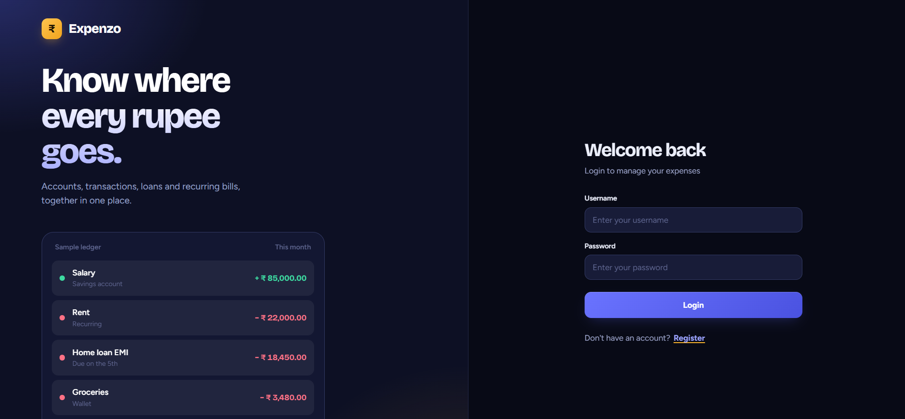

### 🏦 Account Management
- Create and manage multiple financial accounts.
- Maintain account-specific balances.
- Track transactions associated with different accounts.

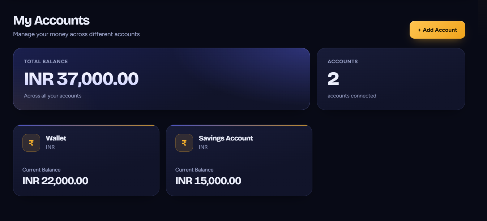

### 💸 Transaction Management
- Record income and expenses.
- Organize and review financial transactions.
- Associate transactions with accounts.
- Keep account balances synchronized with financial activity.

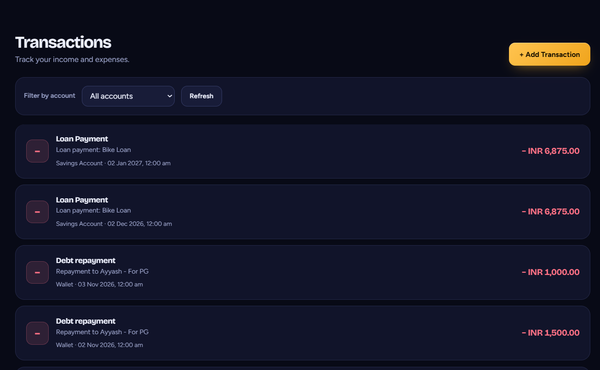

### 🔄 Recurring Payments
- Create, view, update, pause, resume, and delete recurring payments.
- Configure payment frequency and upcoming due dates.
- Set reminders before payments become due.
- Mark recurring payments as paid and update the next due date.

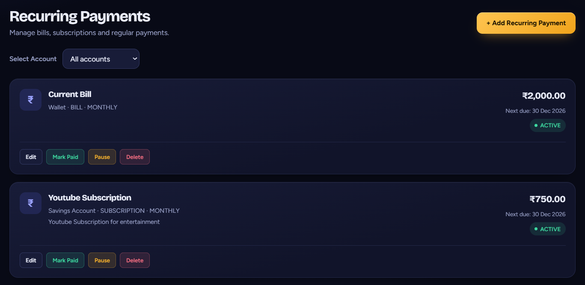

### 🏠 Loan Management
- Record and manage loans.
- Calculate estimated repayment amounts and monthly instalments.
- Track upcoming loan payments.
- Update loan information as repayments are made.

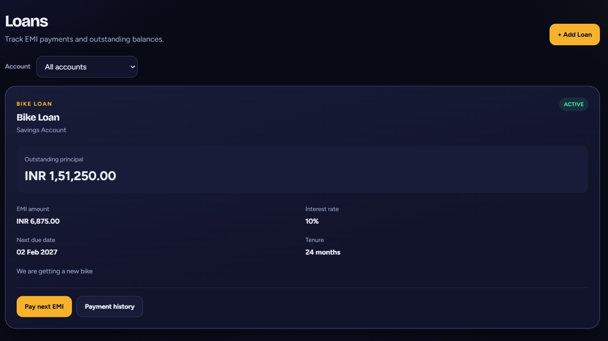

### 🤝 Debt Management
- Track money owed to others and money owed to you.
- Record repayments and maintain outstanding balances.
- Receive reminders for pending debts.
- Keep debt information updated after repayments.

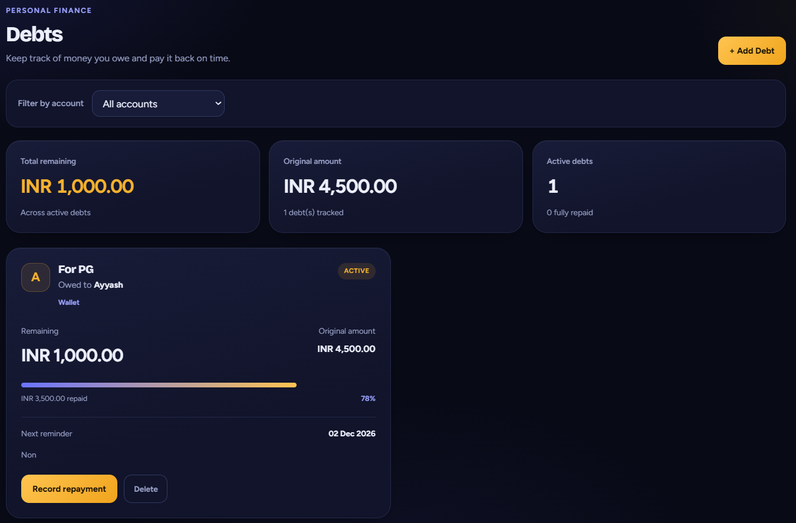

### 🔔 Notifications
- Receive notifications about relevant financial activities and upcoming payments.
- Use Server-Sent Events (SSE) for server-to-client notification streaming.
- Store notifications in the database.
- Track read and unread notification status.

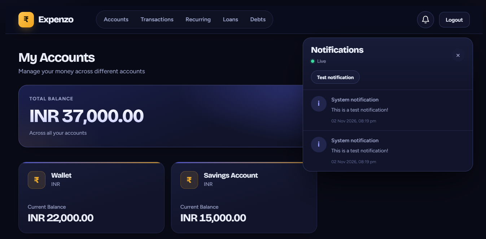

### 📊 Financial Statistics & Insights

- View a consolidated overview of income, expenses, and account balances.
- Analyze income and expense trends through visual charts.
- Monitor financial activity across different time periods.
- Compare income and expenses to understand financial patterns.
- Gain insights into overall financial activity through statistical visualizations.

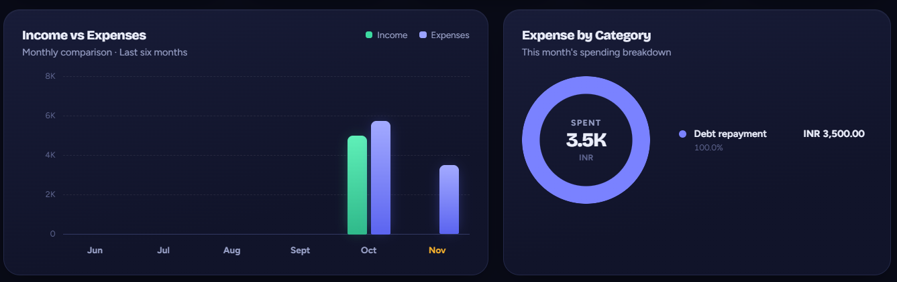

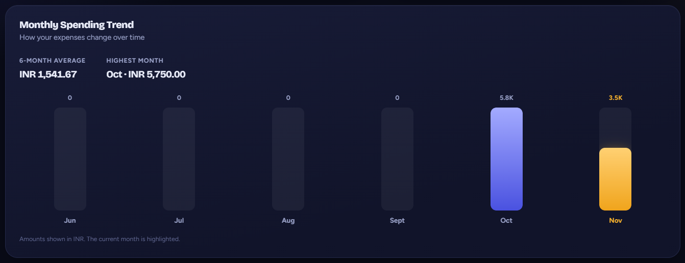

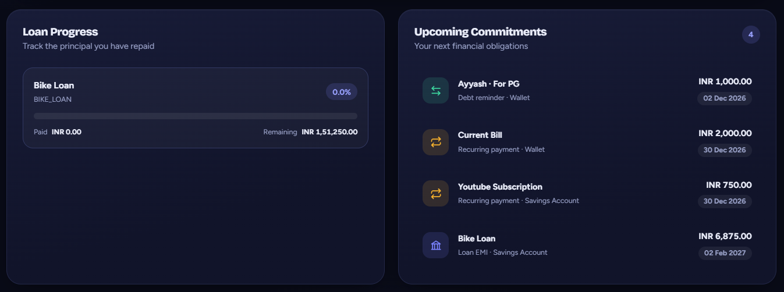

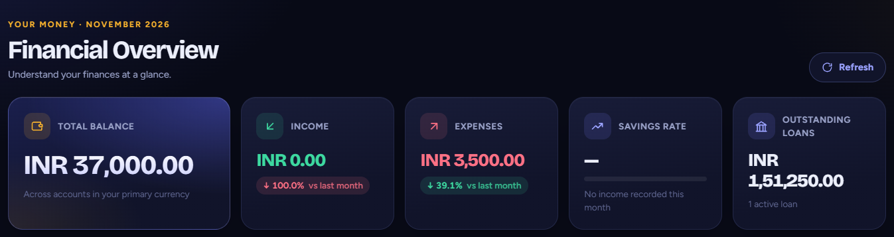

### 🐳 Docker Support
- Containerize the frontend, backend, and database.
- Configure services using Docker Compose.
- Run the application in a consistent development environment.

## 🛠️ Tech Stack

| Layer | Technologies |
|---|---|
| Frontend | React, JavaScript, Vite, HTML, CSS |
| Backend | Java, Spring Boot |
| API | RESTful APIs |
| Authentication | Spring Security, JWT |
| Database | MySQL |
| ORM | Spring Data JPA, Hibernate |
| Real-time Notifications | Server-Sent Events (SSE) |
| Build Tool | Maven |
| Containerization | Docker, Docker Compose |
| Version Control | Git, GitHub |

## 🏗️ Application Architecture

Expenzo follows a client-server architecture.

```text
                 ┌──────────────────────┐
                 │      React UI        │
                 │     React + Vite     │
                 └──────────┬───────────┘
                            │
                    HTTP / REST API
                    JWT Authentication
                            │
                 ┌──────────▼───────────┐
                 │   Spring Boot API    │
                 │                      │
                 │ Controllers          │
                 │ Services             │
                 │ Repositories         │
                 │ Security / JWT       │
                 │ Notification Logic   │
                 └──────────┬───────────┘
                            │
                      Spring Data JPA
                            │
                 ┌──────────▼───────────┐
                 │       MySQL DB       │
                 │                      │
                 │ Users and Accounts   │
                 │ Transactions         │
                 │ Loans and Debts      │
                 │ Recurring Payments   │
                 │ Notifications        │
                 └──────────────────────┘
```

### How It Works

1. Users register or log in through the React frontend.
2. The backend authenticates users and issues JWTs.
3. The frontend includes the JWT when accessing protected API endpoints.
4. Spring Security validates authentication and establishes the user's security context.
5. Controllers handle HTTP requests, services implement business logic, and repositories interact with MySQL through JPA.
6. The notification system can stream updates to connected clients using SSE.

## 📁 Project Structure

The project is organized into separate frontend and backend applications.

```text
Expenzo_App/
│
├── expenzoback/
│   ├── src/
│   │   └── main/
│   │       ├── java/
│   │       └── resources/
│   ├── pom.xml
│   └── Dockerfile
│
├── expenzofrontend/
│   ├── src/
│   │   ├── components/
│   │   ├── services/
│   │   └── ...
│   ├── package.json
│   └── Dockerfile
│
├── docker-compose.yml
└── README.md
```

> **Note:** Adjust the directory names above if your repository uses a different structure.

## 🚀 Getting Started

### Prerequisites

Install the following tools before running the application:

- [Git](https://git-scm.com/)
- [Docker Desktop](https://www.docker.com/products/docker-desktop/)
- [Java JDK](https://adoptium.net/) and [Maven](https://maven.apache.org/) if running the backend outside Docker.
- [Node.js](https://nodejs.org/) and npm if running the frontend outside Docker.

### 1. Clone the Repository

```bash
git clone https://github.com/afdhalcodes/Expenzo_App.git
cd Expenzo_App
```

### 2. Configure the Application

Review the backend configuration and Docker Compose file.

Configure the required database connection settings, database credentials, JWT signing secret, and any other environment variables required by the application.

**Important:** Do not commit real passwords, JWT secrets, or other sensitive configuration values to GitHub.

### 3. Run with Docker Compose

From the project root directory, run:

```bash
docker compose up --build
```

To run the services in the background:

```bash
docker compose up --build -d
```

To inspect running containers:

```bash
docker compose ps
```

To view application logs:

```bash
docker compose logs -f
```

To stop the application:

```bash
docker compose down
```

The application URLs and database port depend on the ports configured in `docker-compose.yml`.

For the local development configuration used during development:

- Frontend: http://localhost:5173
- Backend API: http://localhost:8080
- MySQL: localhost:3307

## 🔒 Security Considerations

- Protected endpoints require valid authentication.
- JWTs are used to authenticate API requests.
- Database credentials and signing secrets should be supplied through environment-specific configuration.
- Production deployments should use HTTPS and appropriately secured database connections.
- Financial data should only be accessible to its authorized owner.

## 🎯 Learning Outcomes

This project demonstrates practical experience with:

- Building REST APIs using Spring Boot.
- Implementing JWT authentication with Spring Security.
- Designing relational database entities and relationships.
- Using Spring Data JPA and Hibernate for database operations.
- Developing interactive frontend components using React hooks.
- Integrating frontend and backend services.
- Implementing recurring payment and loan repayment logic.
- Handling real-time server-to-client notifications with SSE.
- Containerizing a full-stack application using Docker Compose.
- Managing source code and project versions with Git and GitHub.

## 🔮 Future Improvements

Potential enhancements include:

- Spending analytics and monthly financial reports.
- Budget limits and category-wise spending insights.
- Exporting financial reports to CSV or PDF.
- Browser push notifications.
- Automated integration tests and CI/CD pipelines.

## 👨‍💻 Author

**Afdhal Mohamed A**

- GitHub: [@afdhalcodes](https://github.com/afdhalcodes)
- Project Repository: [Expenzo_App](https://github.com/afdhalcodes/Expenzo_App)

---

*Expenzo is a personal software development project built to explore full-stack development, financial data management, authentication, real-time communication, and containerized application deployment.*
